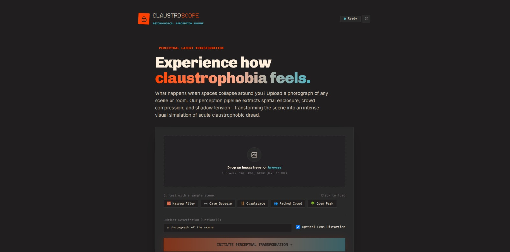
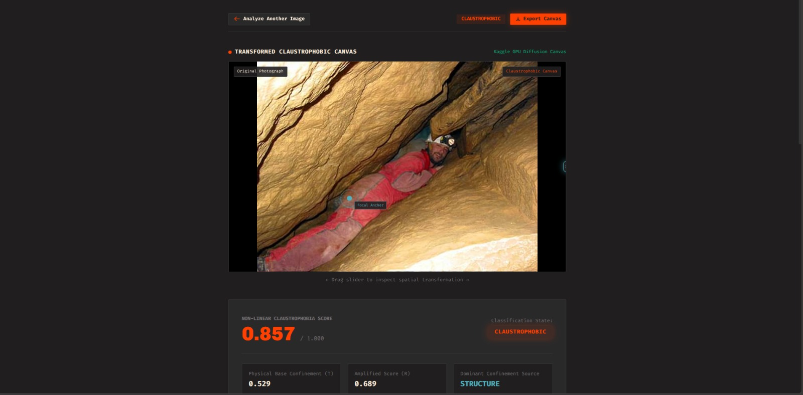
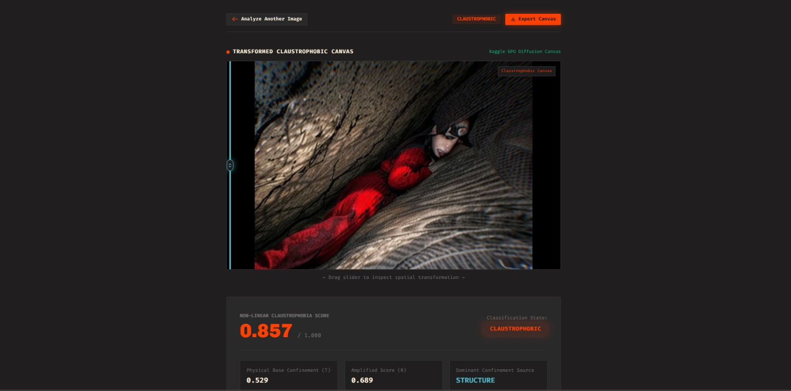

# ClaustroScope

ClaustroScope is an artificial intelligence pipeline that evaluates how claustrophobic an image looks and regenerates it into a psychologically distorted canvas reflecting the state of mind of someone trapped inside.

If a photograph shows an open place (like a park or beach), the pipeline preserves its natural perspective. If a photograph shows an enclosed, crowded, or dark space (like a crawlspace, cave squeeze, narrow alley, or packed subway), the pipeline bends the walls inward, darkens the outer margins into tunnel vision, and uses generative diffusion to recreate the feeling of acute confinement.

---

## Visual Showcase

### Landing & Upload Interface
The landing page allows users to drag and drop any photograph or select one of five pre-loaded sample scenes (Narrow Alley, Cave Squeeze, Crawlspace, Packed Crowd, Open Park). Users can optionally customize the prompt description and toggle optical lens distortion.



### Focal Anchor Detection & Confinement Scoring
Once analyzed, the dashboard presents the scene with the detected focal crosshair anchor centered on the primary subject, alongside the real-time calculated Claustrophobia Score (C = 0.857), classification state (CLAUSTROPHOBIC), and foundational confinement metrics (T, R, and dominant source).



### Transformed Claustrophobic Diffusion Canvas
An interactive Before / After split slider lets users sweep across the scene to inspect the generative transformation. Guided by Depth and Canny ControlNets, the model bends structural boundaries inward and compresses peripheral space into an intense claustrophobic canvas.



---

## Architecture Overview

The system is organized into four sequential stages, connected through a web application.

```
[ Input Photograph ]
         |
         v
[ Stage 1: Feature Extraction ]
  Depth Anything V2, SegFormer ADE20K, YOLO11-Pose, OpenCV
         |
         v
[ Stage 2: Claustrophobia Scoring ]
  Physical Confinement (T) -> Amplifiers (R) -> S-Curve Score (C)
         |
         v
[ Stage 3: Conditioning & Spatial Modulation ]
  Radial Vignette, Depth Warping, Edge Jitter, Lens Distortion
         |
         v
[ Stage 4: Generative Multi-ControlNet Diffusion ]
  Realistic Vision v6.0 with Depth & Canny ControlNets
         |
         v
[ Final Transformed Canvas ]
```

---

## Pipeline Stages

### Stage 1: Feature Extraction
The system inspects the input photograph using four vision tools to extract eight normalized values between 0.0 and 1.0:
* **Depth Anything V2 Small:** Measures 3D distance. It calculates Border Closeness (how close ceilings and side walls are to the camera lens) and Depth Flatness (lack of distance variation, like facing a flat wall).
* **SegFormer (ADE20K):** Identifies semantic scene categories. It calculates Wall & Ceiling Ratio (enclosing structures) and Sky & Open Ratio (visible sky, water, or open fields).
* **YOLO11-Pose:** Locates people and tracks 17 bodily keypoints. It calculates Body Compression (limbs huddled close to the torso) and Crowd Density (multiple occluded people packing the frame).
* **OpenCV:** Computes Darkness Level (shadow submersion in HSV space), Edge Clutter (jagged high-frequency detail via Canny filtering), and Chromatic Warmth (warm light emitted from lamps and windows).

### Stage 2: Claustrophobia Scoring
A deterministic mathematical formula combines the extracted features into a single score C between 0.000 and 1.000:
1. **Physical Confinement Base (T):** Evaluates if you are physically blocked by walls or crowded by people, counterbalanced by visible open sky.
   ```
   T = max((0.60 * D_border + 0.40 * S_enc), P_crowd) * (1.0 - S_sky)
   ```
2. **Atmospheric Amplifiers (R):** Darkness, surface clutter, and huddled postures increase tension, while warm lamp lighting reduces it.
   ```
   R = T * (1.0 + 0.35 * L_dark + 0.25 * E_clutter + 0.20 * P_comp - 0.65 * L_warm)
   ```
3. **Logistic S-Curve Mapping (C):** Converts R into a final score C centered at threshold 0.49 with steepness 9.0.
   ```
   C = 1 / (1 + exp(-9.0 * (R - 0.49)))
   ```

* **OPEN (C < 0.35):** Wide natural spaces. Geometry remains undistorted.
* **ENCLOSED (0.35 <= C < 0.65):** Standard rooms and hallways. Mild framing is applied.
* **CLAUSTROPHOBIC (C >= 0.65):** Tight spaces and heavy crowds. Full optical and generative horror distortion is applied.

### Stage 3: Spatial Conditioning & Modulation
Before sending data to the image generator, OpenCV functions warp the guiding maps according to score C:
* **Radial Vignette:** Darkens the outer perimeter into an elliptical tunnel vision mask centered on the detected person.
* **Inward Depth Warping:** Coordinate remapping bends vertical walls and ceilings inward over the viewer.
* **Edge Jitter:** Adds random spatial displacement to background edges while preserving the primary person.
* **Barrel Lens Distortion:** Applies non-linear optical bowing that pulls walls into a fishbowl dome and adds subtle peripheral chromatic color splitting when C >= 0.35.

### Stage 4: Generative Multi-ControlNet Diffusion
The system sends the vignetted photo, warped depth map, and jittered edge lines to a Stable Diffusion v1.5 model (Realistic Vision v6.0) guided by two ControlNet adapters (Depth and Canny):
* Diffusion parameters (denoising strength, guidance scale, steps, and prompt weights) scale dynamically with score C.
* Generates an expressive visual canvas reflecting internal psychological dread.
* Can run locally for fast optical previews (under 0.5 seconds) or connect to a remote Kaggle GPU worker for full diffusion rendering.

---

## Web Dashboard

The application features a single-column vertical web interface designed for clarity and psychological immersion:
* **Landing Page:** Minimal upload interface with five one-click sample scenes (Narrow Alley, Cave Squeeze, Crawlspace, Packed Crowd, Open Park).
* **Loading Screen:** Animated particle splashscreen with live elapsed timer while neural models execute.
* **Results Flow:** Single vertical scroll displaying the transformed canvas with an interactive Before / After split slider, numeric fear score and classification, eight feature progress bars, four intermediate conditioning maps, and synthesized diffusion prompts.

---

## Deployment Architecture

ClaustroScope uses a multi-tier hybrid deployment topology that distributes workloads across the best-suited hardware environments.

```
+-------------------------------------------------------------------------+
|                              USER CLIENT                                |
|             Browser visiting https://your-project.vercel.app            |
+-------------------------------------------------------------------------+
       |                                                   |
       | 1. GET /api/config                                | 2. Direct POST /api/analyze
       |    (Edge discovery)                               |    (Bypasses Vercel limits)
       v                                                   v
+-------------------------------+       +---------------------------------+
|       VERCEL EDGE TIER        |       |       CLOUDFLARE TUNNEL         |
|  - Static Assets (HTML/CSS/JS)|       |  https://xxxx.trycloudflare.com |
|  - Edge Route (/api/config)   |       +---------------------------------+
+-------------------------------+                          |
                                                           v
                                        +---------------------------------+
                                        |      PRIMARY ENGINE TIER        |
                                        |  Local Workstation (Port 8000)  |
                                        |  - FastAPI (app.py)             |
                                        |  - Stage 1: Vision Models       |
                                        |  - Stage 2: Claustro Scoring    |
                                        |  - Stage 3: Spatial Warping     |
                                        +---------------------------------+
                                                           |
                                                           | (Optional Remote Call)
                                                           v
                                        +---------------------------------+
                                        |     GENERATIVE WORKER TIER      |
                                        |  Remote Kaggle GPU (T4 16GB)    |
                                        |  - Gradio Server                |
                                        |  - Stage 4: Multi-ControlNet    |
                                        |  - Realistic Vision SD1.5       |
                                        +---------------------------------+
```

### Why This Architecture Was Chosen

1. **Bypasses Serverless Platform Limitations:**
   Standard serverless hosting providers like Vercel have hard constraints:
   * Request body size is limited to 4.5 MB on standard tiers.
   * Execution timeout is 10 to 60 seconds.
   * Serverless execution environments lack GPU hardware and cannot run multi-gigabyte PyTorch models (Depth Anything V2, SegFormer, and YOLO11-Pose require ~2.2 GB of memory).
   By decoupling the web presentation layer from the compute engine, the browser fetches engine endpoints directly via secure HTTPS tunnels.

2. **Direct Browser-to-Engine Communication:**
   When the user opens the Vercel site, the frontend automatically queries `/api/config` to read `PRIMARY_ENGINE_URL`. All heavy file uploads and inference requests are transmitted directly between the user's browser and the primary processing engine.

3. **In-Memory Model Caching:**
   The primary processing engine initializes the neural network models once during startup inside FastAPI's application lifespan context. Models remain resident in GPU/RAM, reducing Stage 1 to 3 execution time to ~0.35 seconds per request.

4. **Ephemeral Request Isolation:**
   Each analysis request executes inside an isolated directory (`/tmp/claustrophobia_web_runs/<uuid>`). Artifacts are converted into Base64 data representations for the frontend response, and temporary disk files are immediately cleaned up.

5. **Fault-Tolerant Tiering:**
   If the remote Kaggle diffusion worker is offline or experiences network delays, the primary engine automatically catches the error and returns the local Stage 3 optical distortion preview. The web client continues to function seamlessly without crashing.

---

## Deployment Playbook

### Option 1: Vercel Hybrid Cloud Deployment (Recommended)

This setup gives you a public web application hosted on Vercel backed by your local GPU for fast inference.

#### Prerequisites
* Node.js and npm (or GitHub integration with Vercel)
* Cloudflare Tunnel CLI (`cloudflared`) installed on your local workstation
* Python virtual environment with dependencies installed

#### Step 1: Start the Local Primary Engine
```bash
cd claustroscope
source venv/bin/activate
uvicorn app:app --host 0.0.0.0 --port 8000
```

#### Step 2: Forward Port 8000 via Cloudflare Tunnel
In a second terminal:
```bash
cloudflared tunnel --url http://127.0.0.1:8000
```
Note the generated HTTPS URL (for example: `https://example-subdomain.trycloudflare.com`).

#### Step 3: Deploy to Vercel
1. Import this repository in your Vercel dashboard.
2. In **Project Settings** > **Environment Variables**, define:
   * `PRIMARY_ENGINE_URL`: Your Cloudflare tunnel URL from Step 2 (e.g., `https://example-subdomain.trycloudflare.com`).
   * `KAGGLE_TUNNEL_URL` (optional): Active Kaggle GPU tunnel URL if running Stage 4 diffusion.
3. Click **Deploy**.

The Vercel site is now live. You can also manually inspect or change the engine URL at any time using the gear icon in the top-right corner of the website header.

---

### Option 2: Standalone Local Deployment

To run both the backend server and frontend on your local machine:

1. Clone the repository:
   ```bash
   git clone https://github.com/nixnord/claustroscope.git
   cd claustroscope
   ```

2. Create and activate a virtual environment:
   ```bash
   python3 -m venv venv
   source venv/bin/activate
   ```

3. Install dependencies:
   ```bash
   pip install -r requirements.txt
   ```

4. Start the server:
   ```bash
   uvicorn app:app --host 0.0.0.0 --port 8000
   ```

5. Open your browser and navigate to:
   ```
   http://localhost:8000
   ```

---

### Option 3: Hugging Face Spaces (Containerized Cloud Hosting)

The repository includes a production `Dockerfile` configured for Hugging Face Spaces (CPU Basic 16 GB RAM or ZeroGPU):

1. Create a new Space on [Hugging Face Spaces](https://huggingface.co/new-space).
2. Choose **Docker** as the SDK and select **Blank template**.
3. Push this repository to your Space Git remote:
   ```bash
   git remote add space https://huggingface.co/spaces/<username>/<space-name>
   git push space main
   ```
4. Hugging Face will build the container, install system libraries (`libgl1`, `libglib2.0-0`), configure non-root user permissions, and bind to port `7860`.

---

### Option 4: Remote Kaggle GPU Generative Worker

To enable Stage 4 generative diffusion rendering using a free Kaggle T4 GPU:

1. Create a Kaggle notebook with **GPU T4 x2** enabled.
2. Copy and execute `kaggle_gradio_server.py` in the notebook.
3. The script will download Realistic Vision v6.0 and ControlNet weights, then print a public Cloudflare tunnel URL:
   ```
   Running on public URL: https://xxxx.trycloudflare.com
   ```
4. Add this URL to your `.env` file or export it as an environment variable:
   ```env
   KAGGLE_TUNNEL_URL=https://xxxx.trycloudflare.com
   ```
5. If running on Vercel, set `KAGGLE_TUNNEL_URL` in your Vercel Environment Variables.

---

## Environment Variables

| Variable | Description | Default |
| :--- | :--- | :--- |
| `PRIMARY_ENGINE_URL` | Public URL of the primary inference engine (FastAPI) | `""` (uses local origin `/`) |
| `KAGGLE_TUNNEL_URL` | Public URL of the remote Kaggle GPU Gradio diffusion worker | `""` (falls back to local optical preview) |

---

## Repository Structure

* `app.py`: FastAPI backend server managing model lifecycles and analysis routes.
* `index.html`: Web interface featuring single-column vertical layout, loading animation, and results telemetry.
* `vercel.json`: Vercel configuration for clean URL routing.
* `api/config.js`: Vercel Edge Function providing dynamic environment configuration to the browser.
* `extractors.py`: Stage 1 feature extractors (Depth Anything V2, SegFormer, YOLO11-Pose, OpenCV).
* `scorer.py`: Stage 2 claustrophobia formula calculations, classification, and prompt generation.
* `modulators.py`: Stage 3 OpenCV spatial warps, radial vignettes, and barrel lens distortion.
* `pipeline.py`: Stage 4 orchestrator connecting Stages 1-3 to the Stage 4 diffusion client.
* `client_pipeline.py`: Asynchronous bridge client communicating with the remote Kaggle worker.
* `kaggle_gradio_server.py`: Remote server script for Multi-ControlNet Stable Diffusion inference.
* `run_tests.py`: Automated verification test suite.
* `requirements.txt`: Python package dependencies.
* `Dockerfile`: Container definition for Hugging Face Spaces or containerized cloud hosting.
* `test/`: Sample input photographs covering open, enclosed, and claustrophobic scenes.
